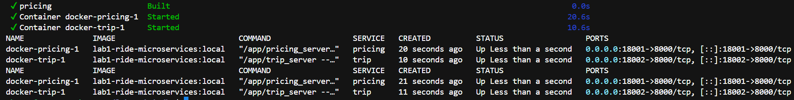
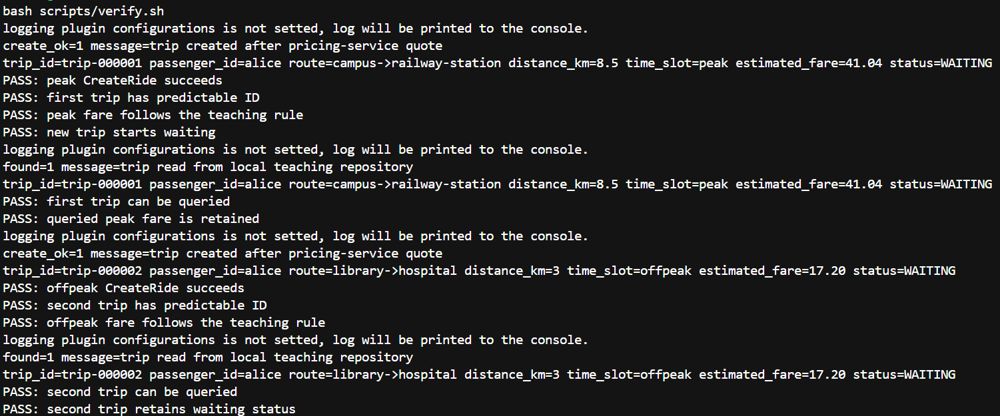
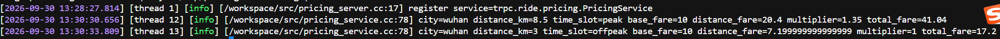
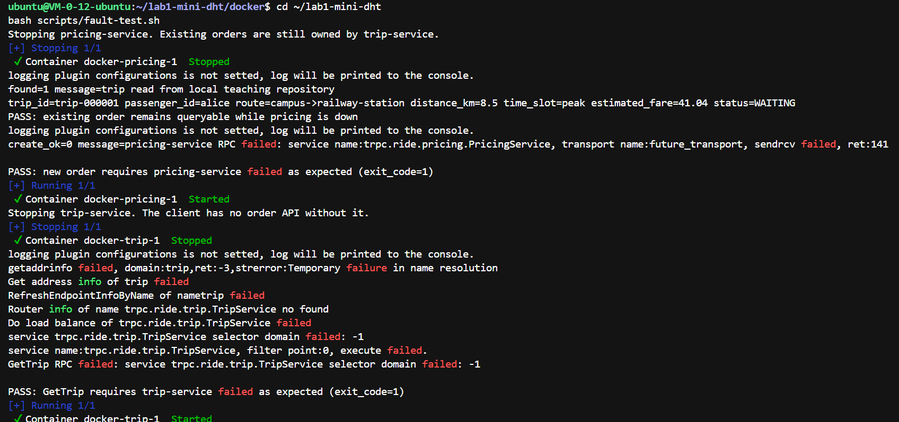
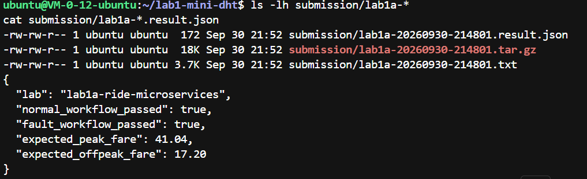

# 实验一 A 报告：基于 tRPC 的网约车订单微服务

## 1. 小组与环境

- 成员与分工
- 平台：腾讯云 Ubuntu Server 24.04 LTS x86_64
- Docker 与 Docker Compose 版本：Docker version 29.1.3，Docker Compose version 2.40.3+ds1-0ubuntu1~24.04.1
- 基础镜像 ID：sha256:18530f877a0aa07e6480397b61225eebc8c39080d7718488e6507f77031acce0

## 2. 场景与服务划分

画出 `ride-client → trip-service → pricing-service` 的调用图，并回答：

```text
ride-client
    |
    | CreateRide / GetTrip
    v
trip-service
    |
    | EstimateFare
    v
pricing-service

trip-service 本地内存表：tripId -> Trip
```

1. 每个组件各自拥有哪类职责与数据？
   - `ride-client`：命令行客户端，只负责构造请求、调用订单服务的 `CreateRide` / `GetTrip` 并打印结果，不保存业务数据。
   - `trip-service`：拥有订单生命周期和订单数据。1A 阶段使用内存表 `tripId -> Trip` 保存订单，负责生成订单号、保存计价结果和 `WAITING` 状态，并在创建订单时调用计价服务。
   - `pricing-service`：拥有计价规则和报价数据。它根据城市、距离和时段计算起步价、里程价、倍率及总价，不保存订单。

2. 为什么计价逻辑应由 `pricing-service` 集中维护？
   - 计价规则只有一个权威实现，避免多个服务复制公式后产生不一致。
   - 调整起步价、里程价或高峰倍率时，只需修改并发布计价服务。
   - 订单服务只关心“取得报价并保存订单”，职责边界清楚，便于测试、监控和故障隔离。

3. Proto 相对于临时拼接 JSON，为协作带来什么约束？
   - Proto 明确定义服务方法、字段名称、字段类型和编号，形成可版本化的接口契约。
   - 客户端和服务端由同一份 Proto 生成 stub，减少字段拼写、类型和序列化不一致。
   - 接口变化可在编译阶段发现，而不是等运行时解析 JSON 失败；同时便于不同语言实现互操作。

## 3. 正常调用实测

使用乘客 `alice` 创建至少两笔订单：一笔平峰、一笔高峰。提交原始终端输出或 CSV；下表可直接填写。

| tripId | 乘客 | 路线 | 距离 km | 时段 | 预估车费 | 状态 | GetTrip 成功 |
|---|---|---|---:|---|---:|---|---|
| `trip-000001` | alice | 校园 → 火车站 | 8.5 | 高峰 | 41.04 | WAITING | 是 |
| `trip-000002` | alice | 图书馆 → 医院 | 3.0 | 平峰 | 17.20 | WAITING | 是 |

附上订单服务与计价服务的关键日志，并说明一次 `CreateRide` 涉及的 RPC 调用顺序。

一次 `CreateRide` 的调用顺序：

1. `ride-client` 向 `trip-service` 发起 `CreateRide`。
2. `trip-service` 校验订单参数，构造 `EstimateFareRequest`。
3. `trip-service` 通过 tRPC 调用 `pricing-service.EstimateFare`。
4. `pricing-service` 使用离线计价规则计算 `(10.0 + distance_km * 2.4) * multiplier`，返回报价。
5. `trip-service` 在计价成功后生成 `trip-xxxxxx`，保存报价和 `WAITING` 状态，然后向客户端返回 `Trip`。

关键日志截图应包含：

```text
trip-service: trip_id=trip-000001 ... downstream=pricing-service estimated_fare=41.04
pricing-service: city=wuhan distance_km=8.5 time_slot=peak ... total_fare=41.04
```

## 4. 故障观察

- 停止的服务：`pricing-service`，随后又停止 `trip-service`。
- `pricing-service` 停止后，已创建订单仍可查询，因为订单正文和状态由 `trip-service` 的内存表持有。新订单在 `trip-service -> pricing-service.EstimateFare` 这一步失败，客户端收到 `create_ok=0` 和下游 RPC 失败信息。
- `trip-service` 停止后，客户端既不能创建也不能查询订单。查询 `GetTrip` 时客户端无法解析或访问 `trip` 服务，因此 RPC 失败。
- 依赖关系：客户端强依赖 `trip-service`；`trip-service` 在创建新订单时依赖 `pricing-service` 获取报价，但已有订单查询不依赖计价服务。这说明计价服务是订单创建路径上的下游依赖。
- 生产改进优先级：优先增加有限重试、超时和熔断，避免计价服务故障拖垮订单服务；同时增加错误率、RPC 延迟和下游可用性监控。若业务允许，还可短期缓存近期报价或提供降级策略。

## 5. 与实验 1B 的衔接

1A 中订单存在哪里？1B 中如何将它替换为以 `trip:<tripId>` 为 key 的 DHT 存储，同时保持 `CreateRide` 和 `GetTrip` 接口不变？

1A 中订单保存在 `TripServiceImpl::trips_` 的进程内存 `unordered_map` 中。1B 可以保持 `CreateRide` 和 `GetTrip` 的 Proto、客户端调用方式和顶层业务不变，只把底层仓储替换为 DHT 客户端：

- `CreateRide` 在取得计价报价后生成 `tripId`，将 `Trip` 序列化，调用 DHT `Put("trip:" + tripId, value)`。
- `GetTrip` 使用 `Get("trip:" + tripId)` 读取并反序列化为 `Trip`；不存在时仍返回 `found=false`。
- 建议抽出订单仓储接口，例如 `SaveTrip` / `LoadTrip`，1A 使用内存实现，1B 使用 DHT 实现，从而隔离存储变化。

## 6. AI/人分工

| AI 帮我做了什么 | 我亲自修改/验证了什么 | 为什么必须由人完成 |
|---|---|---|
| 阅读 Proto、服务和构建脚本；实现计价校验与公式；完成订单服务跨服务调用；定位 Docker 构建、生成代理、DNS 选择和线程模型问题；整理报告结论。 | 在腾讯云 CVM 上部署环境、上传源码、执行构建和验证命令；核对 `41.04`、`17.20`、`WAITING`；运行正常链路和故障测试并保存输出。 | 需要真实验证云主机、Docker 网络和终端输出；需要判断截图证据是否完整，并对最终提交内容和分工真实性负责。 |

## 7. 证据清单

- `docker compose ps` 截图：

- `bash scripts/verify.sh` 截图：两笔订单均通过，价格为 `41.04`、`17.20`，状态均为 `WAITING`。

- 服务日志截图：`trip-service` 显示创建订单和调用下游计价服务，`pricing-service` 显示对应计价结果。

- `bash scripts/fault-test.sh` 截图：现有订单在计价服务停止后仍可查询，新订单失败；订单服务停止后查询失败。

- 提交材料截图：`submission/lab1a-*.tar.gz` 和同名 `.result.json`，其中两个工作流标志均为 `true`。
